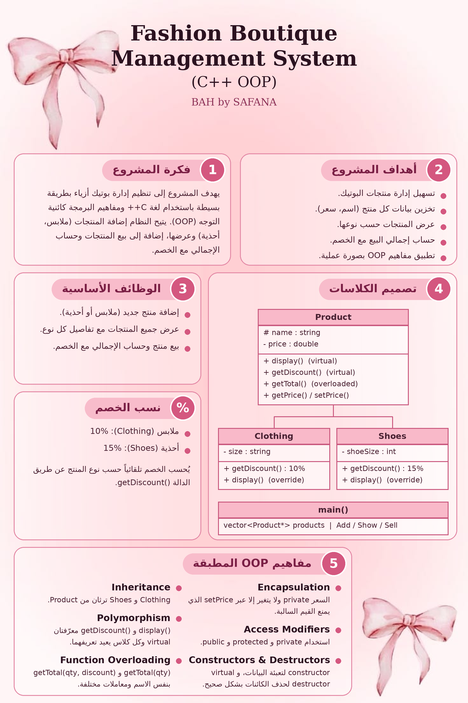

# fashion-boutique-oop
Fashion boutique management system in C++ using OOP concepts (classes, inheritance, polymorphism, encapsulation, function overloading).
# BAH by SAFANA - Fashion Boutique Management System





## Project Description
A console-based fashion boutique management system written in C++. The user can add products (clothing and shoes), display them, and sell them with an automatic discount calculation.

This project was developed individually to apply Object-Oriented Programming (OOP) concepts.

## Project Objectives
- Apply OOP concepts in a practical, real-life application.
- Manage boutique products (add and display).
- Calculate the sale total with and without discount.
- Provide a simple text-based user interface.

## Classes
| Class | Description |
|---|---|
| `Product` | Base class: name, price, display and discount functions |
| `Clothing` | Inherits from Product, adds size (10% discount) |
| `Shoes` | Inherits from Product, adds shoe size (15% discount) |

## OOP Concepts Applied

| Concept | Where it is used |
|---|---|
| Classes and Objects | `Product`, `Clothing`, `Shoes` |
| Encapsulation | `price` is `private`, changed only through `setPrice()` which rejects negative values |
| Access Modifiers | `private` (price), `protected` (name), `public` (functions) |
| Constructors | `Product(name, price)` and the constructors of the child classes |
| Destructors | `virtual ~Product()` prints a message when a product is deleted |
| Inheritance | `Clothing` and `Shoes` inherit from `Product` |
| Polymorphism | Virtual functions `display()` and `getDiscount()` overridden in each child class |
| Function Overloading | `getTotal(quantity)` and `getTotal(quantity, discountPercent)` |

## Features
1. Add a product (Clothing or Shoes)
2. Show all products
3. Sell a product (shows total before and after discount)

## How to Compile and Run

Requirements: a C++ compiler (g++) with C++11 or later.

**Compile:**
```
g++ -std=c++11 -o boutique main.cpp
```

**Run (Linux / macOS):**
```
./boutique
```

**Run (Windows):**
```
boutique.exe
```

## Notes
- Product names must be entered without spaces (use `_`, e.g. `Classic_Blazer`).
- Discounts: Clothing 10%, Shoes 15%.